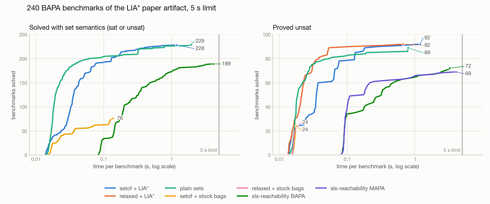

# cvc5 with sets converted to bags, on the BAPA benchmarks

This compares cvc5's conversion of sets to bags ([cvc5#13106](https://github.com/cvc5/cvc5/pull/13106)) together with its LIA* solver for bags ([cvc5#12974](https://github.com/cvc5/cvc5/pull/12974)) against cvc5's sets solver and against sls-reachability. The benchmarks are the 240 BAPA benchmarks of the LIA* paper artifact in [`benchmarks/bapa`](../../benchmarks/bapa).



The left panel only shows configurations whose answers hold for the sets. The right panel compares the `unsat` answers of all configurations: an `unsat` answer for the multiset reading of a benchmark also holds for the sets. A PDF version is in [`cactus.pdf`](cactus.pdf).

## Configurations

| Configuration | Tool and options | Reads the benchmarks as |
|---|---|---|
| plain sets | cvc5 | sets |
| plain sets, `--fmf-bound` | cvc5 `--fmf-bound` | sets |
| setof + stock bags | cvc5 `--sets-to-bags=setof --fmf-bound` | sets |
| relaxed + stock bags | cvc5 `--sets-to-bags=relaxed --fmf-bound` | multisets |
| setof + LIA* | cvc5 `--sets-to-bags=setof --bags-to-liastar` | sets |
| relaxed + LIA* | cvc5 `--sets-to-bags=relaxed --bags-to-liastar` | multisets |
| sls-reachability BAPA | `lia_star_solver.py` | sets |
| sls-reachability MAPA | `lia_star_solver.py --mapa` | multisets |
| sls-reachability MAPA, unfold | `lia_star_solver.py --mapa --unfold=5` | multisets |
| sls-reachability MAPA, no interpolation | `lia_star_solver.py --mapa --no-interp` | multisets |

`--sets-to-bags=setof` wraps every converted set term in `bag.setof`, which keeps the semantics of sets. `--sets-to-bags=relaxed` drops `bag.setof` except for set unions, which turns the problem into a multiset problem. cvc5 reports `unknown` instead of `sat` in that mode, since a model of the bags need not be a model of the sets. The stock bags solver reduces `bag.card` to quantified formulas, which need `--fmf-bound` to answer `sat`.

## Results

| Configuration | unsat | sat | unknown | timeout | error | solved | median time |
|---|---|---|---|---|---|---|---|
| cvc5, sets solver | 89 | 140 | 0 | 11 | 0 | 229 | 0.019 s |
| cvc5, sets solver, `--fmf-bound` | 89 | 0 | 140 | 11 | 0 | 89 | 0.016 s |
| cvc5, `--sets-to-bags=setof`, stock bags solver | 24 | 52 | 0 | 164 | 0 | 76 | 0.023 s |
| cvc5, `--sets-to-bags=relaxed`, stock bags solver | 24 | 0 | 109 | 107 | 0 | 24 | 0.016 s |
| cvc5, `--sets-to-bags=setof --bags-to-liastar` | 92 | 136 | 11 | 1 | 0 | 228 | 0.035 s |
| cvc5, `--sets-to-bags=relaxed --bags-to-liastar` | 92 | 0 | 146 | 2 | 0 | 92 | 0.021 s |
| sls-reachability, BAPA | 72 | 117 | 0 | 51 | 0 | 189 | 0.196 s |
| sls-reachability, MAPA (`--mapa`) | 69 | 110* | 0 | 61 | 0 | 179 | 0.184 s |
| sls-reachability, MAPA, `--unfold=5` | 65 | 115* | 0 | 60 | 0 | 180 | 0.269 s |
| sls-reachability, MAPA, `--no-interp` | 59 | 112* | 0 | 69 | 0 | 171 | 0.136 s |

\* Satisfiable as a multiset problem, which does not make the set problem satisfiable.

The median time is taken over the solved benchmarks. Times are measured around the solver process, so they include its startup: about 0.015 s for cvc5, and about 0.08 s for sls-reachability, which starts Python and loads z3. Per-benchmark answers and times are in [`results.csv`](results.csv), and this table is also in [`summary.csv`](summary.csv).

## Observations

- **LIA\* is what makes the conversion work.** With the stock bags solver, `setof` solves 76 benchmarks; with LIA\*, it solves 228, close to the 229 of the sets solver, and loses none of the 76.
- **cvc5 with LIA\* proves every `unsat` that any configuration proves.** That is 92 benchmarks, in both modes. It proves 3 that the sets solver does not (`card/fol_0000097`, `card/fol_0000098`, `card/fol_0000107`), 20 that sls-reachability BAPA does not, and 23 that sls-reachability MAPA does not.
- **No configuration contradicts another.** No benchmark is `sat` under set semantics in one configuration and `unsat` in another. No benchmark is `sat` for sls-reachability MAPA and `unsat` for relaxed + LIA\*.
- **`setof` + LIA\* answers `unknown` on 11 `card` benchmarks.** The reason is `BAGS_LIASTAR_MODEL`: the model construction of the LIA\* solver gives up on these `bag.setof` terms. The sets solver answers `sat` on 5 of them and times out on the other 6.
- **The status annotations are not the statuses of these formulas.** All 240 files are annotated `unsat`, but the sets solver finds 140 of them satisfiable. For example, `arith/fol_0000001` has the model n = 1, t = 0, confirmed with `--check-models`, and sls-reachability BAPA finds 117 satisfiable.

## Setup

- **cvc5:** branch [`sets-to-bags-liastar`](https://github.com/mudathirmahgoub/cvc5/tree/sets-to-bags-liastar) at commit [`9fd0ccffd`](https://github.com/mudathirmahgoub/cvc5/commit/9fd0ccffdbe6c20b4e2eaf6aba52f250c6b2afbf), which is cvc5 `main` with cvc5#12974 and cvc5#13106 merged. It was built with `./configure.sh unrestricted --gpl --normaliz --auto-download`.
- **sls-reachability:** `lia_star_solver.py` in this repository, with z3 5.0.0 and Python 3.9.6.
- **Limits:** 5 s of wall-clock time per run. cvc5 got `--tlimit=5000`, and sls-reachability was killed after 5 s. 12 runs went in parallel on an Apple M5 Max (18 cores, 64 GB) with macOS 26.7.1.
- **Benchmark syntax:** for cvc5, the benchmarks are rewritten from z3's set syntax (`card`, `subset`, `intersection`, `setminus`, `union`) to SMT-LIB's (`set.card`, `set.subset`, `set.inter`, `set.minus`, `set.union`). Their status annotations are dropped, see the note above.

## Reproducing

```
python3 run_experiments.py /path/to/cvc5   # with a Python that has z3, see install.sh
python3 report.py                          # needs matplotlib
```

`run_experiments.py` writes `results.csv`. `report.py` writes `summary.csv`, `summary.md`, `cactus.png` and `cactus.pdf` from it. Both scripts locate the benchmarks and their outputs relative to their own location, so they can be run from any directory.
